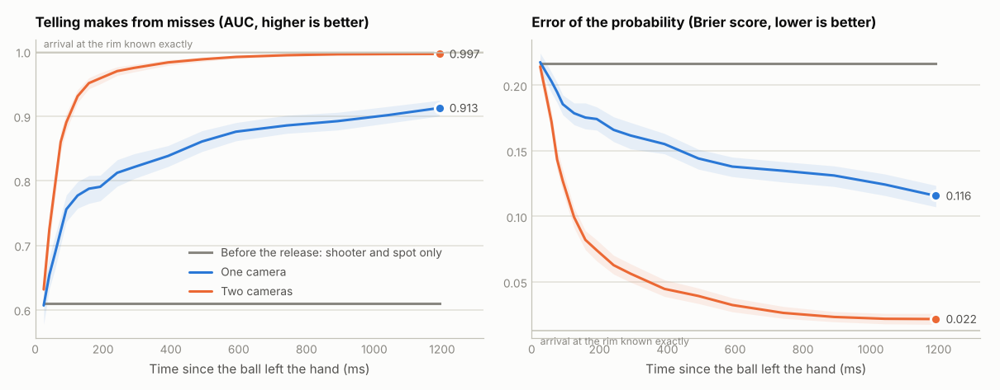
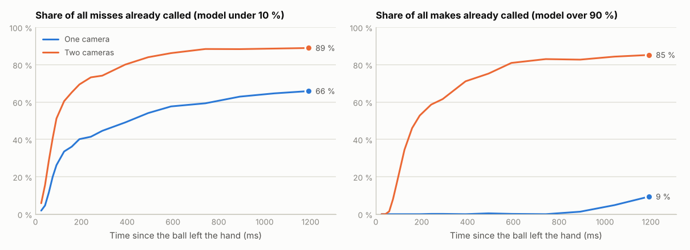
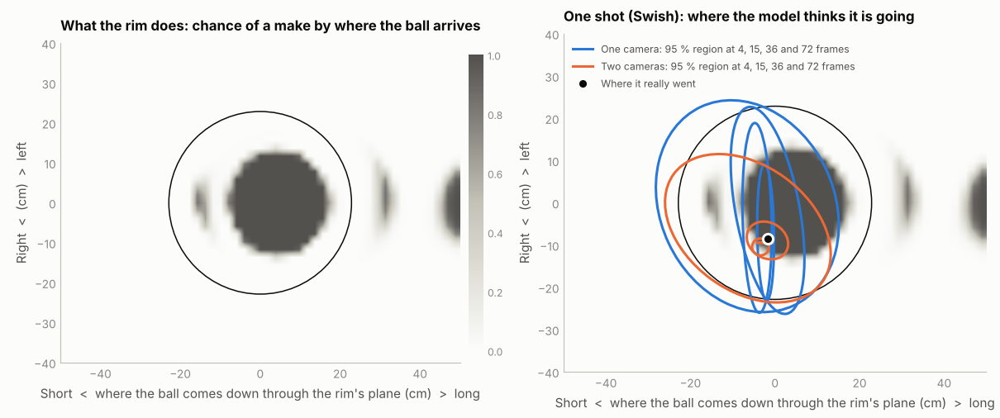
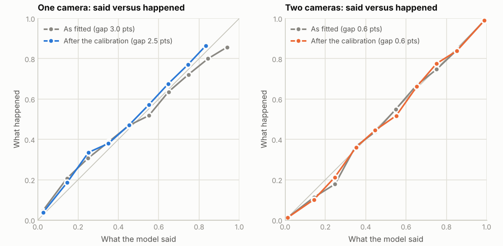
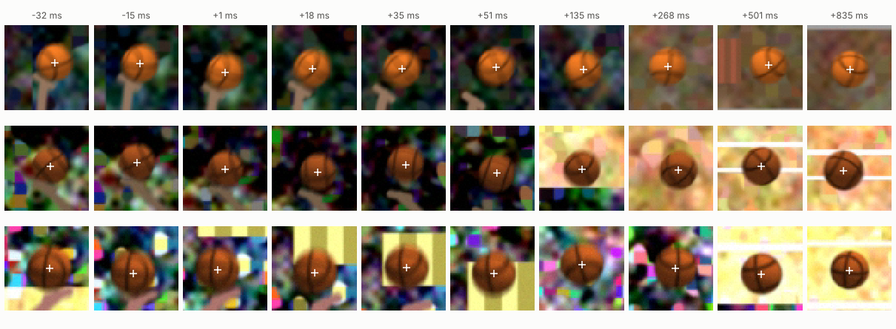

# shotcall

Calling an NBA three while the ball is still in the air.

This is a side experiment. It has nothing to do with the game in this repo and nothing here is used by it.

It started as a thought experiment: could a camera know that a three is going in early enough to bet on it? The answer is no (see [Could you bet on it?](#could-you-bet-on-it)). Working that out properly needed a whole vision pipeline, from pixels to a calibrated probability, and that is what is here.

**Everything is simulated**: the shots, the cameras and the pictures. No game footage was used, and none of these numbers has been checked against a real broadcast. Read the shape of the results, not the decimals.

## The answer

Scored on 2,000 simulated threes that none of the models were fitted on (34 % of them go in). A call is the model being at least 90 % sure, either way. A three is in the air for about 1.4 s.

| | One camera (main broadcast angle) | Two cameras (adds a corner angle) |
|---|---|---|
| Misses already called 0.29 s after the release | 45 % | 74 % |
| Makes already called by then | 0 % | 62 % |
| Misses called by the last look, at 1.19 s | 66 % | 89 % |
| Makes called by the last look | 9 % | 85 % |
| Miss calls that are right, at 0.29 s and at the last look | 95 % and 97 % | 98 % and 99.7 % |
| Make calls that are right, at the last look | 94 % | 99 % |
| Shots that ever get a call | 59 % | 97 % |
| When the first call comes (median) | 0.16 s after the release, 1.16 s before the rim | 0.12 s after the release, 1.23 s before the rim |
| First calls that are right | 90 % | 94 % |

- **A miss can be called early. A make cannot.** From the main camera, 45 % of misses are called within 0.29 s, and those calls are right 95 % of the time. Almost no makes are called in the first three quarters of a second (never more than 3 of the 682), and only 9 % by the last look.
- **A second angle changes that.** With two cameras, 62 % of makes and 74 % of misses are called within 0.29 s, and 97 % of shots get a call, the median one 0.12 s after the release.
- **The rim is not the limit.** Told exactly how the ball arrives, the rim model gets 98 % of shots right (the rest rattle). Everything short of that is measurement.





## Why a make is the hard call

Once the ball leaves the hand, its path is settled: gravity, drag and spin do the rest. So calling the shot is a measuring problem. How well do a few frames pin down where the ball will cross the rim's plane? The rim forgives about ten centimetres either way, so the answer has to be good to a few centimetres from seven metres away.

A camera measures two of the ball's three directions well. The third, toward and away from the lens, comes only from weak hints: how big the ball looks, and how its arc bends under a gravity whose size is known. From the main broadcast camera, a shot from the top of the arc flies across the picture, so short or long shows early and left or right hides in depth. From the corners it is the other way round.

A miss needs one thing to be wrong. A make needs everything to be right, including the direction the camera sees worst. That is why one camera calls misses early and almost never confirms a make, and why a second camera at an angle changes the picture.



Left: what the rim does with a ball, by where it would come down through the rim's plane (learned from 300,000 simulated arrivals). The dark disc is the swish; the marks on the long side are balls that go in off the back of the rim or the glass. Right: one shot, with each model's 95 % region for that crossing point at four moments. One camera's region stays stretched along the direction it cannot see.

## How it works

| Step | What it does | Where |
|---|---|---|
| The world | Ball flight with gravity, air drag and spin lift. Rim, backboard and flange contacts as impulses with restitution and friction on a hollow sphere, so backspin matters. Shot spread tuned to the league's make rate | `shotcall/physics.py`, `shotcall/shots.py` |
| The cameras | A main game camera that pans and zooms with the play, and a fixed second angle behind a corner. Each has a calibration that is slightly wrong, as a real one is | `shotcall/camera.py` |
| The pictures | 64-pixel crops of the ball: shading, seams that turn with the spin, motion blur, a hand that lets go, arms across the ball, a crowd behind, lens blur, noise, 4:2:0 colour | `shotcall/render.py` |
| Find the ball | A small CNN: a heatmap whose soft-argmax is the centre to a fraction of a pixel, plus the size and a full 2x2 error bar for the centre (trained as a Student-t likelihood, because a hand or an arm across the ball gives heavy tails), and a branch of its own for whether a hand still has the ball | `shotcall/detector.py` |
| Spot the release | A change-point test on two clues, the detector's hand flag and whether the ball is still gaining speed across the picture, using only the frames seen so far | `shotcall/tracks.py` |
| Fit the flight | Bayesian fit of nine unknowns (position, velocity, backspin, sidespin, drag) and three calibration errors per camera, by batched Levenberg-Marquardt with Huber weights. Priors say where shooters stand, how threes are launched, and that shooters aim at the rim. The curvature at the answer gives the posterior | `shotcall/estimator.py` |
| Ask the rim | An MLP trained on simulated arrivals gives the chance of a make for any way of arriving. The posterior is pushed through it | `shotcall/models.py` |
| Check the confidence | With one camera the fit grows too sure of itself late in the flight, because the detector's small errors run together from frame to frame. The posterior is widened by one factor per moment, the one that makes the outcomes of held-out shots most likely | `report.py` |

The split between physics and learning is deliberate. The flight is known physics, so it is modelled, not learned. The parts that are learned are the ones with no clean formula: what a ball looks like, what a rim does, and how much to trust the result.

## Results

Before the release, knowing only the shooter and the spot: AUC 0.611, Brier 0.217. With the arrival at the rim known exactly: AUC 0.999, Brier 0.013. AUC is how well makes are ranked above misses (0.5 is a coin). Brier is the squared error of the probability (lower is better).

| After the release | One camera: AUC | Brier | misses called | makes called | Two cameras: AUC | Brier | misses called | makes called |
|---|---|---|---|---|---|---|---|---|
| 25 ms | 0.607 | 0.218 | 2 % | 0 % | 0.632 | 0.214 | 6 % | 0 % |
| 42 ms | 0.654 | 0.210 | 5 % | 0 % | 0.725 | 0.194 | 16 % | 0 % |
| 58 ms | 0.688 | 0.203 | 12 % | 0 % | 0.793 | 0.172 | 29 % | 1 % |
| 75 ms | 0.722 | 0.195 | 20 % | 0 % | 0.860 | 0.143 | 41 % | 8 % |
| 92 ms | 0.756 | 0.186 | 26 % | 0 % | 0.890 | 0.127 | 51 % | 17 % |
| 125 ms | 0.777 | 0.179 | 34 % | 0 % | 0.931 | 0.099 | 60 % | 34 % |
| 158 ms | 0.788 | 0.175 | 36 % | 0 % | 0.951 | 0.082 | 65 % | 46 % |
| 192 ms | 0.791 | 0.174 | 40 % | 0 % | 0.959 | 0.074 | 69 % | 53 % |
| 242 ms | 0.812 | 0.166 | 41 % | 0 % | 0.970 | 0.063 | 73 % | 59 % |
| 292 ms | 0.821 | 0.162 | 45 % | 0 % | 0.975 | 0.056 | 74 % | 62 % |
| 392 ms | 0.839 | 0.155 | 49 % | 0 % | 0.984 | 0.045 | 80 % | 71 % |
| 492 ms | 0.861 | 0.144 | 54 % | 0 % | 0.988 | 0.039 | 84 % | 75 % |
| 592 ms | 0.876 | 0.138 | 58 % | 0 % | 0.992 | 0.032 | 86 % | 81 % |
| 742 ms | 0.886 | 0.135 | 59 % | 0 % | 0.995 | 0.026 | 88 % | 83 % |
| 892 ms | 0.892 | 0.131 | 63 % | 1 % | 0.996 | 0.023 | 88 % | 83 % |
| 1042 ms | 0.902 | 0.124 | 65 % | 5 % | 0.996 | 0.022 | 89 % | 84 % |
| 1192 ms | 0.913 | 0.116 | 66 % | 9 % | 0.997 | 0.022 | 89 % | 85 % |

By where the shot was taken (AUC):

| | Test shots | One camera at 492 ms | at 1042 ms | Two cameras at 492 ms | at 1042 ms |
|---|---|---|---|---|---|
| Near corner (shot goes away from the camera) | 225 | 0.818 | 0.885 | 0.993 | 0.997 |
| Far corner (shot comes toward the camera) | 221 | 0.795 | 0.834 | 0.995 | 0.997 |
| Wing | 852 | 0.849 | 0.888 | 0.984 | 0.996 |
| Top of the arc | 702 | 0.900 | 0.937 | 0.990 | 0.997 |

The pieces, each on shots it had not seen:

- **The world.** 35 % of threes go in, 56 % of the makes without touching anything. Release at 9.4 m/s, 1.36 s in the air, arriving at 50 degrees. Misses spread 19 cm long or short and 12 cm left or right (one standard deviation).
- **The detector.** On the filmed shots the ball is about 31 px across with 4 px of motion blur. Centre error: 0.17 px median, 0.28 px RMS, 0.49 px at the 95th percentile. Size error: 1.6 %.
- **The release.** Seen 22 ms after it happens on average: on the exact frame in 23 % of shots, one frame late in 68 %, later in 8 %, early in 1.2 %.
- **The rim model.** On 30,000 held-out arrivals: Brier 0.016, right 97.7 % of the time.
- **The calibration.** How far "said" is from "happened", averaged over the middle of the flight: 3.0 points as fitted and 2.5 after widening with one camera; 0.6 and 0.6 with two. The widening it learned for one camera: none up to 292 ms, rising to 1.5 times by the end. For two cameras: at most 1.15.





Three shots as camera A sees them, from just before the release. The cross is the detector's centre.

## Why not just train a network on the tracks?

A fair question, so it was tried (`baseline.py`). A two-layer GRU was given what the main camera measures, already turned into angles with the camera's calibration (where the ball is relative to the rim, how that changed since the last frame, how big it looks), plus the shooter's spot and skill. It was told the exact release frame, which the estimator is not, and trained on 60,000 shots to say make or miss at every frame. Both then called the same 2,000 new shots, filmed by a detector whose errors are exactly Gaussian, so neither was helped or hurt by pictures.

| After the release | GRU: AUC | Brier | Physics fit: AUC | Brier |
|---|---|---|---|---|
| 92 ms | 0.691 | 0.204 | 0.737 | 0.192 |
| 292 ms | 0.792 | 0.174 | 0.819 | 0.163 |
| 592 ms | 0.827 | 0.160 | 0.858 | 0.145 |
| 892 ms | 0.835 | 0.157 | 0.889 | 0.130 |
| 1192 ms | 0.839 | 0.155 | 0.920 | 0.108 |

Before the release both start from AUC 0.614, Brier 0.218.

The network gets most of the way and then stalls. For the first few frames the two are level (the network is told the release frame; the fit has to find it). From there the fit pulls ahead, and by the last look it ranks shots at 0.92 against the network's 0.84, with 30 % less error in its probabilities. The last stretch is decided by centimetres at the rim, and those come from equations the fit does not have to learn.

More data, a bigger network or better inputs would narrow the gap: this is one baseline, not a search. The fit has another advantage that this test does not show. It carries over to a new camera position with nothing but that camera's calibration, where a network would need labelled shots filmed from there.

## Could you bet on it?

No, and this was never meant to be tried.

- A three is in the air for 1.36 s.
- From the main camera the first call comes 0.16 s after the release (median), so at best about 1.2 s before the ball arrives, and only on 59 % of shots.
So the model's head start is a fraction of one flight, and every pipe a bettor could use is slower than that by a wide margin. A TV picture reaches a viewer seconds late and a stream later still. Sportsbooks hold in-play bets for a few seconds before taking them, and price from courtside data that arrives faster than any broadcast. (Those delays are typical ranges, not measured here.) Whoever could act on a call this early is already sitting on the fast feed. Sitting in the arena to beat the feed is its own thing, courtsiding, which venues and sportsbooks forbid, and it needs eyes, not a model.

## What is real here and what is not

- No real footage. The detector learned from drawn basketballs. On real frames, compression, bodies, hands and camera cuts would cost it accuracy, and it would need real labelled frames to train on.
- The estimator and the simulator share the same flight equations. It does not know each shot's spin or drag, the detector's errors come from pictures and are not Gaussian, and the calibration is off by a little, but the form of the physics is the same on both sides. Real air and real balls would add a mismatch this study does not have.
- The rim is rigid, with noise on each bounce standing in for everything a real rim and net do.
- Cameras are assumed calibrated to about a pixel, and the ball is assumed found (a rough box around it) in every frame. Both are hard problems of their own on a real broadcast.
- Shot spread, spin and release are plausible guesses tuned to a league that makes about 35 % of its threes. Nothing is fitted to tracking data.
- The estimator is told how good each shooter is on each shot (one number that scales the spread). A real system would have to estimate that from who is shooting and how open they are.
- The priors and the confidence head were fitted on shots from the same simulated league as the test shots, as a real system would be fitted on last season.

## Run it

```bash
pip install -r requirements.txt          # CPU is enough
python -m tests.test_physics             # the world behaves
python -m tests.test_estimator           # the fit is right, and knows how right
python run.py                            # simulate, train, film, call: about 40 minutes on four cores
python report.py                         # results/results.json and the figures
python baseline.py                       # the end-to-end baseline, about 15 minutes
python showcase.py page.html             # the replay page, from showcase.html
```

`SHOTCALL_SMALL=1` runs a toy-sized version of `run.py` in about three minutes. Stages are cached in `.cache/` (`SHOTCALL_CACHE` moves it), so `python run.py infer` reruns only the last one.

## Checks

Run on the final code, on a four-core cloud machine with no GPU.

- `python -m tests.test_physics` passes. In a vacuum the flight matches the textbook parabola to 6e-15 m. A ball dropped dead centre goes in without touching anything; one dropped on the rim does not. With contact noise off, 4,000 of 4,000 shots end the same way as their mirror images. The aim solver hits its target to under a thousandth of a millimetre. Of 60,000 shots, 35.2 % go in.
- `python -m tests.test_estimator` passes. With a detector whose errors are exactly Gaussian, the fit's own error bars for where the ball crosses the rim's plane are honest: squared error over predicted variance is between 0.89 and 1.02 at every moment from 4 frames on, for one camera and for two (1.0 is perfect).
- `python run.py`, `python report.py` and `python baseline.py` produced the numbers and figures above.
- The replay page was opened in a headless browser at desktop and phone width, light and dark: no script errors and no sideways scroll.

What the checks found along the way, and what is left:

- With the real detector's pictures, the one-camera fit is over-sure late in the flight: squared error over variance is about 2.4 at the last look, where the Gaussian test gives 0.94. The detector's errors run together from frame to frame and the fit takes them for independent. The calibration step is the answer to that, and after it "said" and "happened" still differ by 2.5 points on average with one camera (0.6 with two). Modelling the correlation in the fit itself would be the better cure.
- A small network on top of the fit's output was tried first as the calibration and did not help, so it was removed.
- Nothing was checked on real footage. The game's own build was not run: no file of the game was touched.
